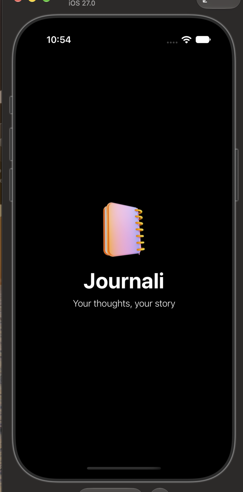
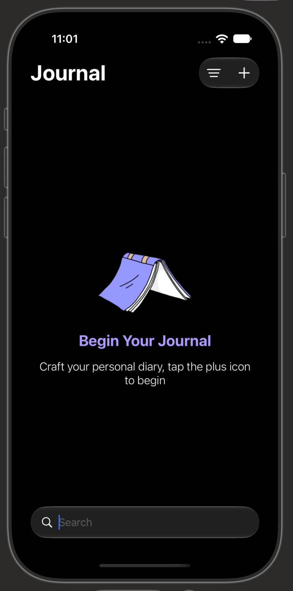
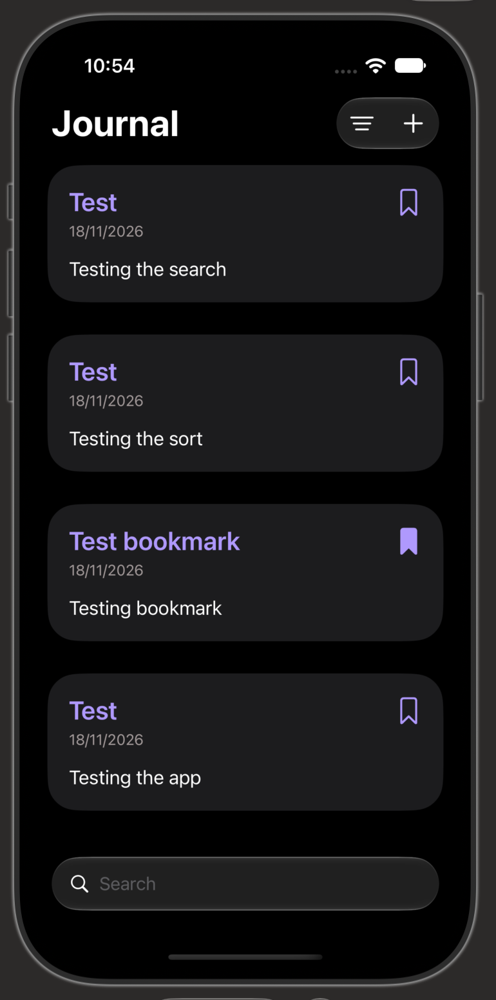
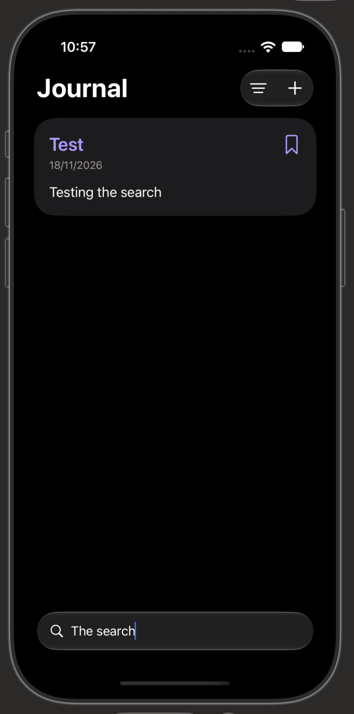
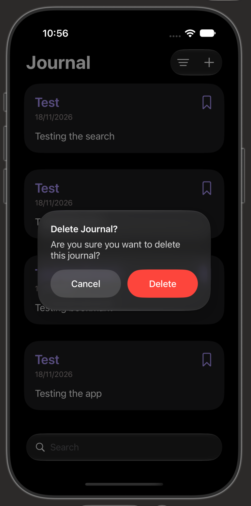
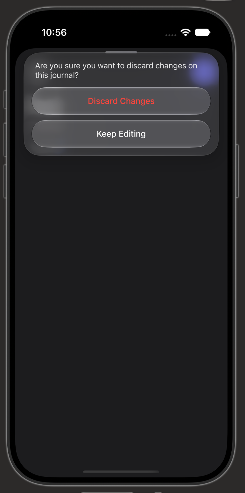

[README.md](https://github.com/user-attachments/files/35015661/README.md)
# Journali

Journali is a personal journaling app for iPhone built with SwiftUI. It lets you write down your thoughts, bookmark the entries that matter, and find any entry quickly with search and sorting.

## Main Features

With Journali, you can:

- Write a new journal with a title and text.
- Edit or delete your journals (swipe to delete, with a confirmation).
- Bookmark your favorite journals.
- Search your journals.
- Sort your journals by entry date or show only bookmarked ones.
- Come back anytime: your journals are saved on your device.

## Screenshots

| Splash | Empty State | Main Page |
|:---:|:---:|:---:|
|  |  |  |

| Search | Delete Alert | Discard Alert |
|:---:|:---:|:---:|
|  |  |  |

## Technologies Used

- **Swift** and **SwiftUI**
- **MVVM** architecture
- **Observation** framework (`@Observable`) for state management
- **Codable + JSON** saved to the device's local storage (Documents directory) for data persistence
- **Liquid Glass** (`glassEffect`) for the UI
- **Xcode** and **Git / GitHub**

## Project Structure

```
Journali/
├── Model/
│   └── JournalEntry.swift        // Data model for a single journal
├── ViewModel/
│   └── JournalViewModel.swift    // State & logic: add, edit, delete, bookmark, search, sort, save/load
├── View/
│   ├── SplashView.swift          // Launch screen
│   ├── EmptyStateView.swift      // Shown when there are no journals
│   ├── MainPageView.swift        // Main list screen
│   ├── HeaderView.swift          // Title, sort menu, and add button
│   ├── SearchBarView.swift       // Search field
│   ├── JournalRowView.swift      // A single journal card
│   └── EditJournalView.swift     // New / edit journal screen
└── JournaliApp.swift             // App entry point
```

The code follows **MVVM**: the Model describes the data, the ViewModel holds the state and logic, and the Views only display data and forward user actions.

## Author

Shahad Alhawas
